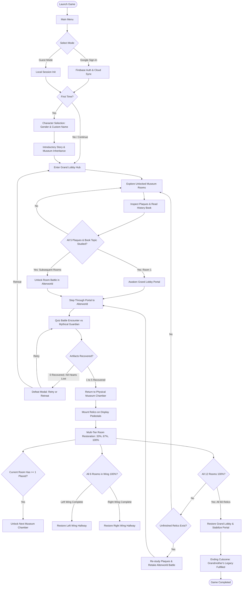
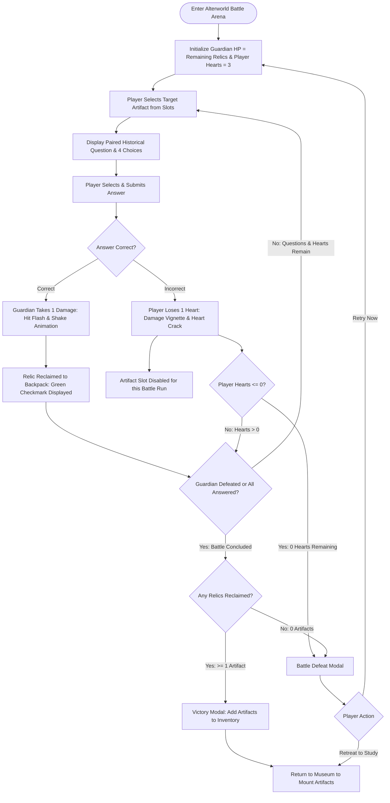

# CHAPTER 3: GAME AND TECHNICAL DESIGN

## 3.1 PROJECT OVERVIEW AND GAME CONCEPT

### Project Overview
*Pamana: A Museum Management System Preserving Philippine History and Culture* is a 2D top-down educational adventure game developed in Unity 6 and deployed via WebGL for modern web browsers. Designed specifically for Junior High School students in Grades 7 to 10 within the Basic Education Department (BED) of the University of Perpetual Help System Laguna (UPHSL) – JONELTA, the project introduces an engaging, interactive medium for studying Philippine history and cultural heritage.

The narrative casts the player as a young student curator who inherits an ancient, dilapidated museum formerly maintained by their grandmother. Within the central atrium, the player discovers an illuminated, enchanted manuscript—the Museum Field Guide (History Book)—which binds the curator to the museum and reveals that the nation's historical memory has been fractured. Supernatural anomalies have siphoned the museum’s sixty historical artifacts into an alternate reality known as the Alterworld (Alternate Museum).

In this study, "museum management" refers to the core gameplay cycle of historical inquiry, artifact reclamation, physical exhibit curation, and progressive architectural renovation. Unlike conventional educational software that relegates learning to disconnected pop-up quizzes, *Pamana* seamlessly weaves curriculum-aligned content into the world itself:
1. **Curatorial Study:** Players explore twelve thematic exhibition chambers, studying contextual artifact plaques and consulting corresponding chapters of the in-game History Book.
2. **Alterworld Expedition:** Once the required materials for a room have been studied, the mystical portal in the Grand Lobby awakens, allowing entry into the Alterworld where mythical guardian creatures possess the missing relics.
3. **Artifact-Specific Quiz Combat:** Players confront guardians in turn-based, quiz-driven battles where each recovered artifact corresponds to a validated curriculum question.
4. **Physical Restoration & Renovation:** Successfully recovered artifacts are brought back to the physical museum and mounted onto their designated display pedestals, triggering visible multi-tier renovations of the rooms, the museum wings, and ultimately the Grand Lobby.

### Game Concept
The game utilizes a top-down 2D perspective featuring responsive pixel-art aesthetics, dynamic 2D lighting, and atmospheric sound design. The museum is structured symmetrically around a central Grand Lobby that connects to two expansive wings: the **Left Wing** (Rooms 1 through 6) and the **Right Wing** (Rooms 7 through 12). Each of the twelve rooms represents a distinct historical or cultural epoch validated by the project's content expert, Ms. Kristel Joice Carlos.

To maintain educational efficacy without causing learner frustration, *Pamana* implements a non-punitive progression system. Players are never blocked from advancing through the museum due to imperfect quiz scores; recovering and restoring even a single artifact from a room is sufficient to unlock the subsequent exhibition chamber. Furthermore, players retain all artifacts recovered during an encounter even if they are defeated, and they can return to previous rooms at any time to review historical notes and re-engage in battle to recover any remaining missing artifacts.

---

## 3.2 GAME DESIGN DOCUMENT (GDD) SUMMARY

### 3.2.1 Genre, Platform, and Target Audience
* **Genre:** 2D Top-Down Educational Adventure / Museum Restoration / Quiz-Based Combat.
* **Platform:** WebGL 2.0 web browser deployment (Google Chrome, Microsoft Edge, Mozilla Firefox, and Safari) accessible on desktop, laptop, and tablet devices without requiring third-party plugins or local client installations.
* **Target Audience:** Junior High School students (Grades 7 to 10) studying Araling Panlipunan / Philippine History, as well as Social Studies educators seeking supplementary digital learning resources.

### 3.2.2 Core Game Mechanics and Game Loop

#### Player Role and Objective
The player assumes the dual role of investigator and museum curator. The primary objective is to study historical records, enter the Alterworld to recover all sixty stolen artifacts from mythical creature guardians, mount them onto their respective exhibition pedestals, renovate all twelve ruined museum chambers and wings, and permanently stabilize the Grand Lobby portal.

#### Key Player Actions
1. **Character Customization:** Choose between a Male ("Boy") or Female ("Girl") student curator avatar and specify a custom curator name (up to 8 alphabetic characters).
2. **Curatorial Exploration:** Navigate the Grand Lobby, exhibition wings, and individual chambers using keyboard controls (WASD / Arrow Keys) or dynamic touch joystick inputs.
3. **Historical Inquiry:** Interact (`[E]` key or on-screen prompt) with unrestored artifact pedestals to inspect missing silhouette profiles, read informative wall plaques, and open the History Book (Field Guide).
4. **Portal Transit:** Step into the awakened Grand Lobby portal to access the Alterworld corridor and select unlocked battle chambers.
5. **Targeted Quiz Combat:** Engage mythical guardians (e.g., Aswang, Kapre, Tikbalang, Bakunawa) by selecting which artifact to target, answering its paired four-choice question, dealing damage to the enemy upon correct answers, and managing player health hearts.
6. **Artifact Mounting:** Return to the real-world museum with recovered artifacts stored in the inventory Backpack, inspect the designated display pedestals, and mount the relics.
7. **Museum Renovation:** Witness the automatic physical transformation of rooms, hallways, and the lobby as restoration thresholds are achieved.
8. **Battle Retake & Mastery:** Re-inspect unrestored artifact pedestals or review completed book chapters to unlock retake encounters where guardians hold only the remaining unrecovered artifacts.

#### Rules and Systems
* **Battle Unlock Condition:** A room’s battle in the Alterworld unlocks only after the player has actively studied all five artifact plaques in that room AND reviewed the matching chapter in the History Book. For Room 1, fulfilling this condition also awakens the dormant Grand Lobby portal.
* **Combat Health & Engagement:**
  * The player enters each battle with **three (3) Hearts**.
  * The guardian's health points directly equal the number of artifacts currently held in that encounter (up to 5 HP).
  * Answering correctly deals 1 damage to the guardian (triggering sprite shake, damage flash, floating text, and audio cues), permanently reclaims that artifact for the player’s Backpack, and marks its slot with a green checkmark.
  * Answering incorrectly deducts 1 Heart from the player (screen damage vignette and audio cue) and disables that specific artifact slot for the remainder of that battle attempt.
* **Battle Outcomes & Resilience:**
  * **Victory / Tactical Retreat:** If the player answers all questions or defeats the guardian, a Victory Modal summarizes recovered relics and returns the player to the museum.
  * **Defeat:** If all 3 Hearts are depleted, a Defeat Modal allows the player to either retry the encounter immediately or retreat to the museum to review historical notes.
  * **Retention:** Any artifacts recovered prior to defeat are permanently kept in the player's Backpack.
* **Room Progression Requirement:** The subsequent exhibition room unlocks when the player recovers and physically mounts **at least one (1) artifact** onto its pedestal in the current room.
* **Retake Mechanics:** Rooms with uncollected artifacts remain eligible for retakes. Reviewing the room’s plaques or book chapter re-arms the portal, and the guardian spawns holding *only* the missing relics.

#### Text Description of the Loop
A new playthrough begins at the Main Menu, where the player chooses Google Authentication or Guest Play, selects character gender and name, and completes an introductory narrative sequence. Exploring the Grand Lobby, the player discovers the History Book on its central pedestal. Entering Room 1, the player studies its five wall plaques and reads Topic 1 in the book. Fulfilling these study requirements awakens the Grand Lobby portal.

Passing through the portal into the Alterworld, the player selects Room 1’s battle chamber and confronts the first guardian (Aswang). Targeting artifacts one by one, the player answers historical multiple-choice questions. Recovered artifacts are added to the Backpack. Returning to the physical museum, the player approaches the empty pedestals and mounts the recovered relics. Placing artifacts initiates progressive room restoration. Once at least one artifact is placed, Room 2 unlocks.

The player repeats this cycle through Rooms 1 to 6 in the Left Wing and Rooms 7 to 12 in the Right Wing. When all rooms in a wing reach 100% restoration, that wing's hallway is restored. When all twelve rooms reach 100% restoration (all 60 artifacts mounted), the Grand Lobby is restored, triggering the final narrative resolution.

#### Short Loop Phrase
$$\text{Curatorial Study (Plaques \& Book)} \longrightarrow \text{Awaken Portal} \longrightarrow \text{Enter Alterworld} \longrightarrow \text{Quiz Combat (Target Relics)} \longrightarrow \text{Mount Recovered Artifacts} \longrightarrow \text{Multi-Tier Room Restoration} \longrightarrow \text{Unlock Next Room} \longrightarrow \text{Wing \& Lobby Restoration}$$

---

### 3.2.3 Story, Narrative, and Worldbuilding

#### Story of the Game
The narrative of *Pamana* centers on themes of generational stewardship, cultural identity, and the danger of historical amnesia. The protagonist inherits an ancestral museum in the historic city of Biñan, Laguna. Upon arriving, the museum lies in ruins—its walls cracked, display tables barren, and historic murals obscured by cobwebs. 

Inside the central lobby, the heir encounters the museum's heirloom: a glowing, enchanted History Book. Upon opening the book, the curator learns that supernatural rifts have scattered the museum's collection into a distorted shadow dimension known as the Alterworld. Mythical creatures of Philippine folklore, corrupted by neglect, guard the stolen artifacts. To honor their grandmother's legacy and restore cultural memory to the community, the young curator must venture through the portal, reclaim each lost relic through historical knowledge, and rebuild the museum.

#### Narrative Integration
*Pamana* rejects passive exposition by embedding historical knowledge directly into curatorial gameplay:
* **Artifact Plaques:** Provide detailed primary-source descriptions, dates, and historical significance.
* **History Book:** Serves as an authentic, beautifully illustrated field guide compiling historical narratives validated by academic historians.
* **Folklore Guardians:** Represent iconic creatures from Philippine mythology (such as the *Duwende*, *Diwata*, *Bakunawa*, *Kapre*, *Manananggal*, and *Tikbalang*), contextualizing local folklore alongside national history.
* **Living Murals & Hallways:** Visual restoration provides tangible proof of cultural recovery. As artifacts return, murals brighten, architectural decay disappears, and festive banners adorn the halls.

---

### 3.2.4 Level and Mission Design

#### Level Structure
The museum is laid out across five distinct exploration zones and twelve individual exhibition chambers:
1. **Grand Lobby (`Lobby.unity` / `AltLobby.unity`):** The central hub containing the History Book pedestal, navigation doorways to the wings, and the mystical Alterworld portal.
2. **Left Wing Hallway (`LeftHallway.unity` / `AltLeftHallway.unity`):** Connects the Grand Lobby to Rooms 1 through 6.
3. **Right Wing Hallway (`RightHallway.unity` / `AltRightHallway.unity`):** Connects the Grand Lobby to Rooms 7 through 12.
4. **Exhibition Chambers (`Room_1.unity` to `Room_12.unity`):** Twelve specialized rooms, each featuring five display pedestals, five informative wall plaques, and an era-specific central historic mural.
5. **Alterworld Battle Arenas (`BattleScene.unity` to `BattleScene_12.unity`):** Twelve ethereal combat arenas where quiz-based guardian encounters occur.

The twelve rooms are divided evenly between the two wings, mapping directly to the twelve validated curriculum topics and twelve History Book chapters:

#### Table 1: Left Wing Museum Rooms, Topics, and Alterworld Guardians
| Room | Historical Topic | Curatorial Focus | Alterworld Guardian |
| :--- | :--- | :--- | :--- |
| **Room 1** | Early Life & Education of José Rizal | Calamba childhood, Biñan schooling, Ateneo & UST studies | Aswang |
| **Room 2** | Literary Masterpieces & Writing | *Noli Me Tángere*, *El Filibusterismo*, and Berlin printing | Duwende |
| **Room 3** | Propaganda Movement & Nationalist Essays | GOMBURZA martyrdom, *Filipinas dentro de cien años*, Malolos Letter | Diwata |
| **Room 4** | La Liga Filipina & Civic Reforms | Ilaya founding, constitution, peaceful reform principles | Bakunawa |
| **Room 5** | Dapitan Exile & Community Leadership | Community school, waterworks, clinic, and scientific specimens | Kapre |
| **Room 6** | Spanish Colonial Administration & Institutions | Governor-General, Royal Audencia, *encomienda*, *bandala*, polo y servicio | Manananggal |

#### Table 2: Right Wing Museum Rooms, Topics, and Alterworld Guardians
| Room | Historical Topic | Curatorial Focus | Alterworld Guardian |
| :--- | :--- | :--- | :--- |
| **Room 7** | The Propaganda Movement & La Solidaridad | Graciano López Jaena, Marcelo H. del Pilar, Madrid expositions | Tikbalang |
| **Room 8** | The Katipunan & The Philippine Revolution | KKK founding, Cry of Pugad Lawin, Kawit proclamation, Tejeros | Sigbin |
| **Room 9** | Precolonial Culture, Artifacts & Traditions | Baybayin script, Laguna Copperplate, *T'nalak* weaving, gold ornaments | Santelmo |
| **Room 10** | Philippine Mythology & Folklore | Creation myths, Bathala, animism, folklore pantheon | Nuno |
| **Room 11** | Philippine Historical Landmarks & Heritage | Intramuros, Paoay Church, Rice Terraces, Vigan colonial architecture | Mangkukulam |
| **Room 12** | Revolutionary Heroes & Key Historical Figures | Bonifacio, Mabini, Tandang Sora, General Antonio Luna, Malvar | Tiyanak |

#### Mission Design & Multi-Tier Restoration System
Each mission follows an organic discovery-recovery-restoration arc within a given room. The physical restoration of the museum occurs across four discrete tiers within each chamber:

* **Tier 0 (0% – Ruined / Neglected):** The initial state of an uncompleted room. Characterized by cracked masonry, heavy debris, spiderwebs, barren pedestals with black silhouette markers, and dim ambient lighting ($0.78$ intensity).
* **Tier 1 (33% – Partial Clearance):** Triggered when **two (2) artifacts** are restored. Debris is cleared, initial structural cracks are repaired, and lighting brightens ($0.88$ intensity).
* **Tier 2 (67% – Advanced Clean Stone):** Triggered when **three to four (3–4) artifacts** are restored. The stone masonry is fully repaired, polished tiled flooring appears, and ambient illumination warms ($0.98$ intensity).
* **Tier 3 (100% – Pristine Golden Sanctuary):** Triggered when all **five (5) artifacts** are restored. The room is transformed into a museum showpiece with polished golden trims, restored historical artwork, pristine lighting ($1.15$ intensity), and celebratory chimes.

Furthermore, *Pamana* introduces **Wing and Grand Lobby Meta-Restoration**:
* **Left Wing Hallway Renovation:** Successfully achieving 100% restoration across all six Left Wing chambers (Rooms 1–6) triggers the permanent restoration of the Left Wing Hallway, transitioning it from a dim corridor to a clean, brightly illuminated gallery.
* **Right Wing Hallway Renovation:** Achieving 100% restoration across all six Right Wing chambers (Rooms 7–12) similarly restores the Right Wing Hallway.
* **Grand Lobby Restoration & Portal Stabilization:** Achieving 100% restoration across all twelve rooms (all 60 artifacts mounted) cleanses the Grand Lobby itself, restoring its golden chandeliers, marble pillars, and stabilizing the mystical portal into a calm historic beacon.

---

## 3.3 USER INTERFACE AND USER EXPERIENCE DESIGN

The UI/UX design of *Pamana* emphasizes period-appropriate visual immersion, low cognitive load, and accessibility for secondary school students. The interface utilizes high-resolution pixel frames, parchment containers, and clear typography powered by TextMeshPro.

### Key Screens and Interfaces
1. **Main Menu Screen:** The entry interface featuring options for *Continue* (loads persistent cloud save for authenticated users), *New Game* (initiates character creation), *Settings*, and *Exit*.
2. **Authentication Modal:** Provides seamless sign-in via Google Identity / OAuth or one-click Guest Play.
3. **Character Selection Screen:** Allows players to select between male and female curator avatars (featuring real-time animated walk cycles) and input a customized curator name (constrained to 8 characters with real-time validation).
4. **Museum Exploration HUD:** Minimalist top-edge HUD displaying current room/wing headers, responsive quick-access buttons for the History Book, inventory Backpack, and Settings modal, alongside on-screen touch joystick controls for mobile users.
5. **History Book (Field Guide) Modal:** A dual-page parchment manuscript interface. Features twelve bookmark tabs, allowing students to browse detailed chapter entries, primary source illustrations, historical dates, and review status.
6. **Artifact Inspection & Mounting UI:** Accessible by approaching pedestals in the museum. Displays the artifact's silhouette or full illustration, curatorial plaque lore, and an interactive "Mount Artifact" button.
7. **Alterworld Quiz Battle Arena:** Displays the animated mythical guardian sprite, enemy health meter (synchronized to remaining artifacts), player health display (three graphical hearts), a top monster dialogue speech container, and four multiple-choice question cards.
8. **Victory & Defeat Result Modals:** Post-battle summaries detailing recovered relics, accuracy, and navigation buttons to return to the museum or retry.
9. **Settings & Accessibility Modal:** Offers granular master, background music (BGM), and sound effects (SFX) volume sliders, audio mute toggles, and text scaling options.

---

## 3.4 SYSTEM ARCHITECTURE AND TECHNICAL SPECIFICATIONS

Figure 2 illustrates the multi-tier system architecture of *Pamana*. The system is structured into four distinct operational layers designed for high responsiveness, cross-platform web compatibility, and low server maintenance.

```
+---------------------------------------------------------------------------------------+
|                             CLIENT & WEB HOSTING LAYER                                |
|  - Modern Web Browsers (Chrome, Edge, Firefox, Safari)                                |
|  - GitHub Pages Static Web Hosting (Production WebGL 2.0 Build deployed to /docs)     |
+---------------------------------------------------------------------------------------+
                                           |
                                           v
+---------------------------------------------------------------------------------------+
|                                 PRESENTATION LAYER                                    |
|  - Unity Canvas UI (Screen Space - Overlay) with TextMeshPro Typography               |
|  - Main Menu & Auth UI  |  Character Selection  |  HUD & Dynamic Touch Controls       |
|  - History Book Modal   |  Artifact Inspection  |  Quiz Battle Arena & Modals         |
+---------------------------------------------------------------------------------------+
                                           |
                                           v
+---------------------------------------------------------------------------------------+
|                       CORE GAME AND APPLICATION LOGIC LAYER                           |
|  - GameManager & SceneManager (State transitions, scene routing)                      |
|  - GameProgression & RoomRestorationController (Multi-tier restoration, wing triggers)|
|  - QuizBattleManager & MonsterBattleController (Damage, health, question validation)   |
|  - TableItemSort & YSort (2.5D dynamic depth sorting, pedestal surface alignment)     |
|  - Dual Persistence Controller (Cloud sync orchestrator + local caching)             |
+---------------------------------------------------------------------------------------+
                                           |
                                           v
+---------------------------------------------------------------------------------------+
|                            EXTERNAL CLOUD SERVICES LAYER                              |
|  - Google Identity Services (OAuth 2.0 Token Generation)                              |
|  - Firebase Authentication REST API (User UID verification and token management)      |
|  - Firebase Realtime Database REST API (JSON document progress synchronization)       |
+---------------------------------------------------------------------------------------+
```
*Figure 2: System Architecture of Pamana.*

### System Layer Architecture Breakdown
1. **Client and Web Hosting Layer:** The compiled Unity WebGL application is hosted on GitHub Pages as a static distribution bundle. Client web browsers execute the WebGL 2.0 WebAssembly canvas natively without requiring client-side installations.
2. **Presentation Layer:** Built using Unity's Universal GUI (UGUI) system and TextMeshPro (TMP). Implements auto-scaling responsive anchors, handling desktop 16:9 widescreen resolutions down to mobile touchscreen viewports.
3. **Core Game and Application Logic Layer:** Contains the runtime C# state engines. Central managers coordinate player movement, collision detection, interaction raycasts, quiz state machines, dynamic 2.5D sorting (`YSort`), multi-tier visual transformations, and game events.
4. **External Cloud Services Layer:** Manages player identity and progress persistence via Google OAuth 2.0 and the Firebase Realtime Database REST API.

---

### 3.4.1 Hardware and Software Requirements

#### Table 3: Hardware Requirements
| Component | Minimum Recommended (Client) | Development Environment |
| :--- | :--- | :--- |
| **Processor** | Intel Core i3 (7th Gen) / AMD Ryzen 3 or equivalent | Intel Core i5 / AMD Ryzen 5 (6 cores) or better |
| **Memory (RAM)** | 4 GB RAM | 16 GB DDR4/DDR5 RAM | 
| **Storage** | 1 GB available disk / browser cache space | 10 GB available SSD space |
| **Graphics** | WebGL 2.0 compatible GPU (Intel HD 620, Vega 8, or better) | Dedicated GPU (NVIDIA GTX 1050 / AMD RX 560 or higher) |
| **Display** | $1280 \times 720$ resolution display | $1920 \times 1080$ Full HD display |
| **Input** | Standard Keyboard & Mouse or Touchscreen interface | Keyboard, Mouse, and High-Resolution Test Monitors |

Table 3 represents the recommended hardware specifications for executing and developing *Pamana*. The client specifications ensure smooth 60 FPS gameplay within modern web browsers across typical public school computer laboratories and student mobile devices.

#### Table 4: Software Requirements
| Software Component | Specification (Client) | Specification (Development) |
| :--- | :--- | :--- |
| **Operating System** | Windows 10/11, macOS, ChromeOS, Android, or iOS | Windows 10 / 11 (64-bit) |
| **Game Engine** | Unity WebGL 2.0 Runtime Player | Unity 6 (Version 6000.0.54f1) |
| **Render Pipeline** | Universal Render Pipeline (2D URP) | Universal Render Pipeline (2D URP) |
| **Programming Language**| C# (.NET Standard 2.1) | C# (.NET Standard 2.1) |
| **IDE / Script Editor** | N/A | Visual Studio Code / Visual Studio 2022 |
| **Cloud Database** | Firebase Realtime Database | Firebase Realtime Database REST API |
| **Authentication** | Google Identity Services (OAuth 2.0) |    |
| **Web Browser** | Chrome 90+, Edge 90+, Firefox 88+, Safari 14+ | Google Chrome (Latest), Edge (Latest) |
| **Version Control** | N/A | Git & GitHub Desktop |

Table 4 outlines the software stack utilized across development and client runtime. Unity 6 was selected due to its advanced 2D Universal Render Pipeline, WebGL 2.0 WebAssembly optimizations, and modular C# environment.

---

### 3.4.2 Game Engine, Tools, and Technologies
Unity 6 (Version 6000.0.54f1) was selected as the core game development engine due to its advanced 2D toolset, high-performance 2D Universal Render Pipeline (URP), and robust WebGL 2.0 WebAssembly compilation capabilities. The 2D URP pipeline enables hardware-accelerated sprite rendering, dynamic 2D lighting (Global Light 2D, torch illumination, and spotlight effects), normal mapping, and custom alpha-blending shaders utilized during the progressive multi-tier restoration of museum exhibition rooms and hallways. 

Programming is executed in C# under the .NET Standard 2.1 profile, adhering strictly to object-oriented software engineering principles and established architectural game patterns:

* **Singleton Pattern:** Employed across foundational service managers (including `GameManager`, `GameProgression`, `AudioManager`, `FirebaseDatabaseManager`, and `FirebaseAuthManager`) to ensure unified global coordination and avoid redundant component instantiation across scene transitions.
* **Finite State Machine (FSM):** Regulates game state lifecycles (`MainMenuState`, `CharacterSelectState`, `ExplorationState`, `DialogueState`, `QuizBattleState`, `RestorationState`, `VictoryState`, and `PauseState`), preventing illegal input actions and race conditions during screen transitions.
* **Observer Pattern / Event-Driven Messaging:** Decouples game systems via static C# `System.Action` events (e.g., `OnPedestalRestored`, `OnRoomRestorationStageChanged`, `OnLeftWingRestored`, `OnRightWingRestored`, `OnLobbyRestored`, `OnBookUnlocked`, and `OnPortalUnlocked`). This enables UI meters, plaque counters, audio listeners, and environmental renderers to react instantaneously to state mutations without tight coupling to combat or progression logic.
* **Dynamic 2.5D Depth Sorting (`YSort` & `TableItemSort`):** A custom mathematical sorting algorithm (`sortingOrder = baseOrder - Mathf.RoundToInt((transform.position.y + offset) * 100f)`) that dynamically shifts sprite draw orders based on vertical foot coordinates, ensuring that characters render behind pedestals when walking behind them and in front when walking before them.

For the development environment, Visual Studio Code was used as the Integrated Development Environment (IDE), providing essential coding features such as real-time static code analysis, debugging tools, syntax highlighting, smart code navigation, and efficient script management. Version control was managed through Git and GitHub Desktop, enabling structured collaboration, commit tracking, and automated static deployment of the WebGL production build to GitHub Pages.

For data handling, the game organizes all educational content—including the sixty historical artifact profiles, plaque descriptions, story dialogues, and quiz question banks—directly within Unity using structured data models. By bundling this historical information directly into the game rather than downloading it from an online server during play, players can inspect artifacts, read plaques, open the History Book, and answer battle questions instantly without lag or loading delays.

To save player progress, *Pamana* uses both online saving and local saving:

* **Online Saving (Firebase Database):** When players sign in with a Google account, their game progress is saved online to Firebase. The database saves the player's chosen character, name, unlocked rooms, collected artifacts, restored pedestals, completed battles, and room restoration stages. This allows players to load and continue their saved game anytime they sign in from a web browser.
* **Local Saving (PlayerPrefs and Guest Play):** While playing, the game uses Unity’s PlayerPrefs and game managers to keep track of progress quickly. For guest players who do not log in, their progress is kept temporarily during their current play session. For logged-in players, local saving allows the game to load rooms and battles smoothly without waiting for an internet response.
* **Automatic Saving:** The game saves automatically whenever important actions happen, such as finishing a battle, placing an artifact on a pedestal, picking up an item, or moving between rooms. Players do not need to save manually, ensuring their progress is not lost.

---

## 3.5 GAME FLOW AND DIAGRAMS

### Main Game Flow
The operational lifecycle of *Pamana* links user authentication, character creation, museum inquiry, combat encounters, multi-tier restorations, and narrative progression into a cohesive loop:



### Battle Sequence Flow
The combat encounter is governed by an interactive state loop that prioritizes deliberate player agency over passive questioning:



---

## 3.6 DATA STRUCTURES AND ASSET MANAGEMENT

The Data Structures and Asset Management in *Pamana: A Museum Management System Preserving Philippine History and Culture* refers to the organized handling and storage of system data and game resources to support smooth operation, maintainability, and efficient performance. During development, structured data formats are utilized to manage quiz content, user progress, and gameplay logic, while a centralized system is implemented to organize assets such as sprites, user interface elements, audio files, scripts, and prefabs. This approach ensures seamless integration between the Unity game engine and the system's components, enabling consistent data flow, easier updates, and an optimized development workflow.

### Table 5: Main Assets of PAMANA

| Main Assets | |
| :--- | :--- |
| **Asset Folder** | **Description** |
| TextMesh Pro | Contains the fonts that are used in the game. |
| Animation | Contains the player movement and interactive portal animations used in the game. |
| Sprites | Contains the 2D sprites, historical artifacts, character avatars, room backgrounds, and environmental structures used in the game. |
| Prefabs | Contains the reusable game object templates such as the player controller, pedestals, and user interface canvas used in the game. |
| Audio Effect | Contains the background music (BGM) and sound effects (SFX) used in the game. |

The Main Assets directory serves as the foundational architecture for the project's resource management, organizing all essential game components into specialized sub-folders for streamlined development. This structure categorizes visual elements, such as the TextMesh fonts, Animation sequences, and 2D character and artifact Sprites, alongside environmental assets and specific Prefabs for interactive pedestals and player models. Additionally, the Audio Effect folder centralizes all sound design elements, ensuring that every sensory component of the game is logically mapped and easily accessible for implementation.

### Table 6: Text Mesh Assets of PAMANA

| Text Mesh | | | |
| :--- | :--- | :--- | :--- |
| **Asset_Folder** | **Type** | **Description** | **File Name** |
| Text Mesh Pro | TrueType Fonts | Vector-based fonts that maintain quality at any size | LiberationSans.ttf |
| Text Mesh Pro | ASSET | TextMeshPro (SDF) asset for text rendering solution with high-quality text | LiberationSans SDF.asset |

Table 6 shows the content of the Text Mesh Assets that serves as the central repository for the game's typography, housing all font files and character sets required for the user interface and in-game displays.

### Table 7: Animation Assets of PAMANA

| Animation | | | |
| :--- | :--- | :--- | :--- |
| **Asset_Folder** | **Type** | **Description** | **File Name** |
| Animation | CONTROLLER | Animator controller for male player movement (idle and 4-directional walk) | Boy_Walk.controller |
| Animation | CONTROLLER | Animator controller for female player movement (idle and 4-directional walk) | Girl_Walk.controller |
| Animation | CONTROLLER | Animator controller for the mystical swirling portal in the Grand Lobby | Portal_Spin.controller |

Table 7 lists the animation assets and controllers that manage dynamic sprite transitions, ensuring smooth character movement and engaging visual effects during exploration and scene transitions.

### Table 8: Sprite and Visual Assets of PAMANA

| Sprites and Visuals | | | |
| :--- | :--- | :--- | :--- |
| **Asset_Folder** | **Type** | **Description** | **File Name** |
| Sprites/Artifacts | Sprite (2D and UI) | 60 historical artifact display sprites across 12 museum rooms | ManunggulJar.png, GoldenTara.png, Balangay.png, Spoliarium.png |
| Sprites/Characters | Sprite (2D and UI) | Player curator avatars and Alterworld guardian battle portraits | Avatar_Boy.png, Avatar_Girl.png, Avatar_Monster.png |
| Sprites/RoomStages | Sprite (2D and UI) | 4-tier museum room stage illustrations (Dilapidated to Restored) | Room_Area_Ruined.png, Room_Area_33Percent.png, Room_Area_Restored.png |
| Sprites/UI | Sprite (2D and UI) | Interactive interface frames, inventory bag, dialogue boxes, and buttons | BagInventory_Frame.png, Btn_Interact_Normal.png, Settings_Scroll_Frame.png |

Table 8 presents the Sprite and visual assets that form the visual identity of Pamana. These assets represent the authentic Philippine historical artifacts, player avatars, multi-tier room backgrounds, and thematic user interface elements that immerse students in the museum curation experience.

### Table 9: Prefab Assets of PAMANA

| Prefabs | | | |
| :--- | :--- | :--- | :--- |
| **Asset_Folder** | **Type** | **Description** | **File Name** |
| Prefabs | PREFAB | Reusable player controller with movement, collision, and interaction detector | Player.prefab |
| Prefabs | PREFAB | Display table pedestal equipped with restoration state triggers and artifact mounting logic | TablePedestal.prefab |
| Prefabs | PREFAB | Core user interface overlay containing the virtual joystick, interaction prompt, and settings | InGameCanvas.prefab |
| Prefabs | PREFAB | Doorway and gateway trigger facilitating seamless scene transitions between rooms and wings | PortalDoor.prefab |

Table 9 highlights the Prefabs used in the game. Prefabs serve as pre-configured, reusable GameObjects that combine visual meshes, colliders, and C# functional scripts into single standardized templates, allowing efficient scene setup and consistent behavior across all 12 museum chambers.

### Table 10: Audio Assets of PAMANA

| Audio Effects | | | |
| :--- | :--- | :--- | :--- |
| **Asset_Folder** | **Type** | **Description** | **File Name** |
| Audio/BGM | Audio Clip | Ambient background music evoking a peaceful museum atmosphere | Museum_Lobby_Theme.wav |
| Audio/BGM | Audio Clip | High-tempo orchestral track for intense Alterworld quiz battles | QuizBattle_Theme.wav |
| Audio/SFX | Audio Clip | Feedback chime played when selecting the correct answer in battle | CorrectAnswer_SFX.wav |
| Audio/SFX | Audio Clip | Impact sound played when an incorrect answer is submitted or health is lost | WrongAnswer_SFX.wav |
| Audio/SFX | Audio Clip | Celebration sound played upon successfully mounting an artifact and restoring a pedestal | Artifact_Restored.wav |
| Audio/SFX | Audio Clip | Tactile sound played when flipping pages in the History Book or pressing UI buttons | Book_PageFlip.wav, UI_ButtonClick.wav |

Table 10 details the audio assets implemented in Pamana. These sound design elements provide vital sensory feedback to players, reinforcing positive reinforcement during quiz victories and establishing distinct audio ambiances between serene museum halls and high-stakes Alterworld encounters.

---

### 3.6.1 Data

### Table 11: Data Architecture and Management

| Data | |
| :--- | :--- |
| **Category** | **Specification** |
| Question Bank | 60 verified curriculum-aligned multiple-choice questions covering 12 historical periods (Pre-Colonial, Spanish, Revolutionary, American, WWII, and Modern Eras), structured with question prompts, four answer options, and verified answer keys. |
| Historical Plaque Descriptions | 60 curated academic narratives detailing the provenance, historical context, and cultural significance of each Philippine artifact. |
| Cloud Database System | Google Firebase Realtime Database (accessed via REST API) for storing user profile names, character choices, unlocked chambers, collected inventory artifacts, restored pedestals, and room restoration stages. |
| Local Session Storage | Unity PlayerPrefs and static GameProgression manager for fast, in-memory state tracking, seamless scene loading, and temporary guest session progress. |
| User Authentication | Google Identity Services (OAuth 2.0) integrated through WebGL for secure student sign-in and cloud profile linking. |

#### Progress and Restoration Tracking System

The progress tracking system in *Pamana* ensures that a player's journey through the museum is saved smoothly and automatically. During active gameplay, Unity's PlayerPrefs and the static manager GameProgression handle fast, in-memory state tracking. For guest players, this manages their progress throughout their play session without requiring an account. For registered players who sign in with their Google account, their data is automatically synchronized to Google Firebase Realtime Database in the cloud.

Progress is saved whenever important milestones occur—such as completing an Alterworld quiz battle, placing a restored artifact onto a pedestal, unlocking a new museum wing, or moving between chambers. The database keeps track of:
1. **Profile Information:** The player's chosen character gender (Curator Boy or Girl) and custom curator name.
2. **Room & Wing Progress:** Which of the 12 exhibition rooms and hallway wings have been unlocked and visited.
3. **Restoration Stages:** The restoration level of each room (from ruined 0% up to fully restored 100%), which updates the visuals of the floors, walls, and lighting.
4. **Pedestal & Artifact Status:** Which of the 60 historical artifacts have been recovered from Alterworld guardians and placed on their respective pedestals.
5. **Inventory Items:** Any artifacts that have been won from quiz battles but not yet placed on display pedestals.

By pairing instant local memory updates with cloud synchronization in the background, the game provides seamless transitions between rooms and battles while ensuring students never lose their hard-earned progress.

Through this comprehensive, unified game and technical design, *Pamana* delivers an academically rigorous, engaging, and resilient learning experience that bridges curriculum-grounded Philippine historical study with modern game-based exploration and museum restoration.

