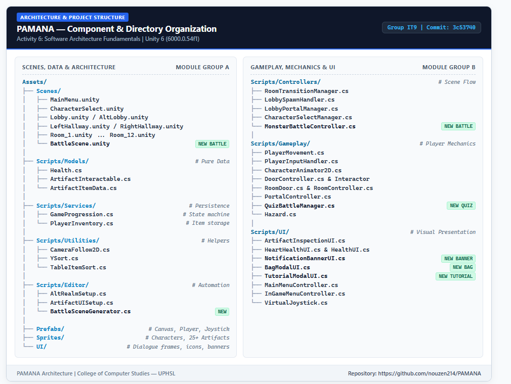

# PAMANA 

**PAMANA** is a 2D top-down educational adventure game developed as a Capstone Project for the **College of Computer Studies at the University of Perpetual Help System Laguna (UPHSL)**.

---

## Project Overview

- **Title**: PAMANA
- **Engine**: Unity 6 (6000.0.54f1)
- **Render Pipeline**: Universal Render Pipeline (2D Core / URP)
- **Target Platform**: PC Windows & Mobile
- **Language**: C# (.NET / Mono)
- **Institution**: University of Perpetual Help System Laguna – College of Computer Studies

---

## Key Features

1. **Dual Character Selection**: Choose between **Darrel** and **Darla** with custom 4-directional animations and dialogue avatars.
2. **Interactive Museum Hub & Alterworld**: Central lobby connecting to Left and Right museum wings with 12 distinct artifact exhibition rooms, plus a mysterious portal to the alternate realm (`AltLobby`, `AltLeftHallway`, `AltRightHallway`).
3. **Artifact Inspection & Lore**: Proximity-based interaction system featuring ornate dialogue banners, silhouette inspection, and educational historical plaques.
4. **Turn-Based Quiz Combat**: Educational monster encounters in the Alterworld where players answer Philippine history trivia to recover stolen relics.
5. **Inventory & Progression Service**: Persistent backpack inventory (`PlayerInventory`) and global state machine (`GameProgression`) tracking room completions, unlocked portals, and relic returns.
6. **Adaptive Controls & HUD**: Support for keyboard (WASD/Arrows) and touch controls via dynamic on-screen Virtual Joystick, alongside Heart health container, notification toasts, and bag modal.

---

## Project Structure

```text
Assets/
├── Prefabs/                  # Reusable game objects (InGameCanvas, Player, Joystick)
├── Scenes/                   # All 16 playable game levels and menu scenes
│   ├── MainMenu.unity
│   ├── CharacterSelect.unity
│   ├── Lobby.unity / AltLobby.unity
│   ├── LeftHallway.unity / AltLeftHallway.unity
│   ├── RightHallway.unity / AltRightHallway.unity
│   ├── Room_1.unity ... Room_12.unity
│   └── BattleScene.unity     # Monster encounter & historical quiz arena
├── Scripts/                  # C# Game Architecture & Components
│   ├── Controllers/          # Orchestration, scene transition & battle flow
│   │   ├── RoomTransitionManager.cs, LobbySpawnHandler.cs, LobbyPortalManager.cs
│   │   └── CharacterSelectManager.cs, MonsterBattleController.cs
│   ├── Gameplay/             # Locomotion, player mechanics & level triggers
│   │   ├── PlayerMovement.cs, PlayerInputHandler.cs, CharacterAnimator2D.cs
│   │   ├── DoorController.cs, DoorInteractor.cs, RoomDoor.cs, RoomController.cs
│   │   └── PortalController.cs, PortalAnimation.cs, QuizBattleManager.cs, Hazard.cs
│   ├── Models/               # Data structures & relic attributes
│   │   ├── Health.cs, ArtifactInteractable.cs, ArtifactItemData.cs
│   ├── Services/             # State machines, persistence & inventory
│   │   ├── GameProgression.cs, PlayerInventory.cs
│   ├── UI/                   # Visual presentations, HUD & modals
│   │   ├── ArtifactInspectionUI.cs, HeartHealthUI.cs, HealthUI.cs
│   │   ├── NotificationBannerUI.cs, BagModalUI.cs, TutorialModalUI.cs
│   │   └── MainMenuController.cs, InGameMenuController.cs, VirtualJoystick.cs
│   ├── Utilities/            # Rendering & depth sorting helpers
│   │   ├── CameraFollow2D.cs, YSort.cs, TableItemSort.cs
│   └── Editor/               # Automation & scene generation tools
│       ├── AltRealmSetup.cs, ArtifactUISetup.cs, BattleSceneGenerator.cs, InGameUISetup.cs
├── Settings/                 # Universal Render Pipeline (URP) 2D assets & profiles
├── Sprites/                  # 2D visual assets (Characters, Enemies, 25+ Artifacts, Environments)
├── TextMesh Pro/             # Dynamic typography assets and shaders
└── UI/                       # Philippine-themed frames, dialogue boxes, backpack & icons
```

<p align="center">
  
</p>

### Architecture & Design Patterns

The codebase is built following clean **Software Architecture Fundamentals** to ensure modularity, maintainability, and ease of expansion:

1. **Layered Architecture & Separation of Concerns (SoC)**
   - **Presentation Layer (UI)**: Pure visual components (`ArtifactInspectionUI`, `NotificationBannerUI`, `HeartHealthUI`, `BagModalUI`) that display gameplay feedback and listen to event subscriptions without manipulating player physics or calling raw storage APIs.
   - **Controller Layer**: Coordinates interaction between inputs and state (`RoomTransitionManager`, `MonsterBattleController`, `PlayerInputHandler`, `DoorInteractor`).
   - **Model & Service Layer**: Stores and serializes in-memory and persistent game state (`ArtifactItemData`, `Health`, `PlayerInventory`, `GameProgression`).

2. **Observer Pattern (Event-Driven Architecture)**
   - Components communicate via decoupled C# `event Action` delegates rather than direct polling or tight object references.
   - Examples:
     - `PlayerInventory.OnInventoryChanged` dynamically refreshes backpack slots when new artifacts are collected.
     - `GameProgression.OnPortalUnlocked` triggers environmental world shifts and notification banners.
     - `Health.OnHealthChanged` notifies heart HUD containers to trigger damage shake animations.

3. **Hybrid Input System**
   - The locomotion engine leverages Unity's New Input System (`InputSystem_Actions`) alongside an onscreen touch-responsive `VirtualJoystick`, allowing seamless gameplay across PC (keyboard/mouse/gamepad) and mobile browsers.

---

### Core Gameplay Subsystems

| Subsystem | Key Components | Technical Description |
| :--- | :--- | :--- |
| **Museum Exploration** | `RoomTransitionManager`, `DoorController`, `RoomDoor`, `LobbySpawnHandler` | Manages directional transitions across 12 distinct museum exhibition rooms, hallway wings, and player spawn orientation. |
| **Alterworld & Portals** | `PortalController`, `LobbyPortalManager`, `PortalAnimation` | Coordinates vortex suction animations, camera transitions, and state checks linking the real museum with alternate realm levels (`AltLobby`, `AltLeftHallway`, `AltRightHallway`). |
| **Turn-Based Combat** | `QuizBattleManager`, `MonsterBattleController`, `BattleSceneGenerator` | Orchestrates educational battle sequences where players answer Philippine history trivia to dispel monsters and reclaim stolen artifacts. |
| **Artifact & Lore System** | `ArtifactInteractable`, `ArtifactInspectionUI`, `TableItemSort` | Proximity-based pedestal triggers supporting silhouette previews, ornate plaques, and 25+ curated pre-colonial and historic artifacts. |
| **Inventory & Quests** | `PlayerInventory`, `BagModalUI`, `GameProgression` | Persistent session tracking for collected relics, pedestal returns, Alterworld door prerequisites, and player progression flags. |

---

## Play in Browser (WebGL)

### 1. Live Online (GitHub Pages)
Once GitHub Pages is activated on the repository, the game is playable directly in any modern desktop or mobile web browser with zero installation:
- **Live URL**: `https://nouzen214.github.io/PAMANA/`

### 2. Offline / Local Testing
To launch and play the built WebGL version locally on your machine without opening Unity:
- Double-click [`Run_WebGL_Game.bat`](file:///Run_WebGL_Game.bat) in the root directory.
- This boots an optimized local web server and opens your default browser at `http://localhost:8000`.

---

## Installation & Setup (Unity Editor)

1. **Prerequisites**:
   - Install **Unity Hub** and **Unity 6 (6000.0.54f1)**.
   - Required Modules: Universal Windows Platform / Standalone Support / WebGL Build Support.
2. **Open Project**:
   - In Unity Hub, click **Add** > select this project folder.
   - Open with Unity 6.0.54f1.
3. **Play in Editor**:
   - Open `Assets/Scenes/MainMenu.unity` and click **Play** (or press Play from any scene; `MainMenu` will automatically run as configured in `GameStartupConfig.cs`).

